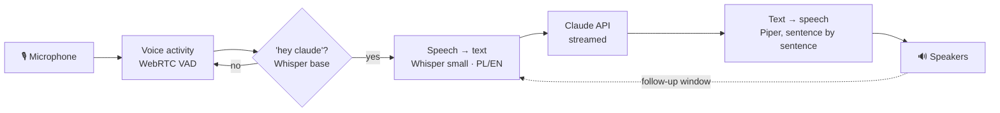

# Vox — "hey claude" for your Linux desktop

A hands-free voice assistant that lives in your system tray. Say **"hey claude"**, ask anything in **Polish or English**, and hear the answer. Wake-word detection, speech-to-text and the voice all run **locally**. Only the text of your question goes to Claude.



## Features

- **Wake word "hey claude"** out of the box, with no training needed. It's fuzzy-matched, so "hej klaud" works too.
- **One breath or two:** "Hey Claude, what's the weather tomorrow?" works, and so does "Hey Claude" (beep) "…what's the weather?"
- **Polish and English auto-detection:** it replies in the language you spoke, with a Polish or English voice to match.
- **Streaming:** it starts speaking after Claude's first sentence instead of waiting for the whole answer.
- **Follow-ups:** after an answer it listens for 5 seconds, so you can continue without the wake word.
- **Short memory:** it remembers the conversation for 5 minutes, then starts fresh.
- **Tray icon:** the colour shows the state (black is ready, blue is listening, amber is thinking, green is speaking, grey is muted).
  - **Left click:** talk now.
  - **Middle click:** mute.
  - **Right click:** menu (type a question, stop, new conversation, settings).
- **Push-to-talk shortcut:** `vox ctl listen`, which you can bind to any key.
- **Optional web search:** for weather and news.

## Install (CachyOS / Arch)

```bash
git clone https://github.com/<you>/vox-assistant.git
cd vox-assistant
./install.sh
```

The installer:

1. Installs `portaudio` and `uv` with pacman.
2. Creates an isolated Python 3.12 environment in `~/.local/share/vox`.
3. Adds a `vox` command, a menu entry and autostart.
4. Runs `vox --setup`, which asks for your **Anthropic API key** (from [platform.claude.com](https://platform.claude.com/settings/keys)), tests it, and downloads the speech models (~600 MB, one time).

Then start it with `vox`, or from the app menu.

> The API is pay-as-you-go and billed separately from a Claude.ai subscription. With the default Claude Haiku 4.5, a typical short spoken question costs a fraction of a cent.

## Usage

| You say | What happens |
|---|---|
| "Hey Claude, ile to jest 17 razy 23?" | Answers in Polish |
| "Hey Claude" … *beep* … "What's a SOC analyst?" | Answers in English |
| *(within 5 s after an answer)* "A po polsku?" | Follow-up, no wake word needed |

From the terminal or a keyboard shortcut:

```bash
vox ctl listen          # push-to-talk
vox ctl stop            # stop speaking
vox ctl toggle-mute
vox ctl ask "jaka jest stolica Australii?"
vox ctl reset           # new conversation
vox ctl quit
```

**KDE shortcut:** System Settings → Keyboard → Shortcuts → *Add New* → *Command or Script* → `vox ctl listen`, then assign e.g. `Meta+Space`.

Other commands:

- `vox --no-tray`: run in the terminal. You can also type questions there.
- `vox --say "Cześć!"`: test the voice.
- `vox --list-devices`: list your microphones and speakers.

## Settings

Edit `~/.config/vox/config.toml` (tray menu → *Open settings*), then choose *Restart*. The most useful settings:

| Setting | Default | Notes |
|---|---|---|
| `claude.model` | `claude-haiku-4-5-20251001` | Fastest. Use `claude-sonnet-5` for harder questions. |
| `claude.web_search` | `false` | Lets Claude look things up (costs extra per search) |
| `claude.location` | `""` | e.g. `"Poznań, Poland"` for weather and local questions |
| `stt.model` | `small` | Use `medium` or `turbo` for better Polish on a fast CPU/GPU |
| `wake.sensitivity` | `0.78` | Lower means it triggers more easily, and more falsely |
| `audio.follow_up_s` | `5` | Set to `0` to always require the wake word |
| `audio.min_volume` | `60` | Raise it if fan noise triggers listening |
| `tts.voices.pl` | `pl_PL-gosia-medium` | Or `pl_PL-darkman-medium`. [Samples](https://rhasspy.github.io/piper-samples/) |

## Privacy

- Audio never leaves your computer: wake-word spotting and transcription run on your CPU/GPU.
- Speech is only checked for the wake phrase. It is not recorded or saved.
- After the wake word, only the **transcribed text** of your question is sent to the Anthropic API.
- The API key is stored in `~/.config/vox/config.toml` with `600` permissions. You can use the `ANTHROPIC_API_KEY` env var instead.

## Lighter wake word (optional)

The default Whisper-based wake word briefly transcribes every burst of speech it hears. That's fine on most laptops but uses some CPU in a noisy room. For near-zero idle CPU:

1. Train a custom "hey claude" model with [openWakeWord](https://github.com/dscripka/openWakeWord#training-new-models). Its Colab notebook takes about an hour and produces a `.onnx` file.
2. Install the optional extra: `uv pip install --python ~/.local/share/vox/venv/bin/python "openwakeword>=0.6"`.
3. In the config, set `wake.engine = "openwakeword"` and `wake.openwakeword_model = "~/.local/share/vox/hey_claude.onnx"`.

## Troubleshooting

- **Nothing happens when I speak:**
  1. Run `vox --no-tray -v` to watch it live.
  2. Check `vox --list-devices` and set `audio.input_device`.
  3. Try lowering `audio.min_volume`.
- **Triggers by itself:** raise `wake.sensitivity` to about 0.85, or raise `audio.min_volume`.
- **Slow transcription:** use `stt.model = "base"`. You can also use an NVIDIA GPU: set `stt.device = "cuda"`, which needs CUDA 12 + cuDNN 9 installed. `auto` falls back to CPU.
- **No tray icon:** Vox falls back to terminal mode. On GNOME, install the *AppIndicator* extension.
- **Logs:** `~/.local/state/vox/vox.log`.

## Development

```bash
uv venv --python 3.12 && uv pip install -e ".[dev]"
sudo pacman -S espeak-ng   # tests synthesise speech to exercise the real VAD
pytest -q
```

Code map:

| File | What it does |
|---|---|
| `vox/audio.py` | mic / speaker |
| `vox/vad.py` | utterance segmentation |
| `vox/wake.py` | wake word |
| `vox/stt.py` | Whisper |
| `vox/brain.py` | Claude |
| `vox/tts.py` | Piper |
| `vox/engine.py` | the loop |
| `vox/tray.py` | UI |
| `vox/ipc.py` | `vox ctl` |

## Uninstall

Run `./uninstall.sh`. Add `--purge` to also delete the config and voices.

---

### Po polsku

Vox to asystent głosowy w zasobniku systemowym. Mówisz „hey Claude” i zadajesz pytanie po polsku albo po angielsku, a Vox odpowiada głosem.

- Rozpoznawanie mowy i głos działają lokalnie. Do Claude trafia tylko tekst pytania.
- Instalacja: `./install.sh`. Ustawienia są w `~/.config/vox/config.toml`.
- Klawisz „naciśnij i mów”: podepnij `vox ctl listen` pod skrót klawiszowy w KDE.

MIT License · Not affiliated with Anthropic. "Claude" is a trademark of Anthropic.
